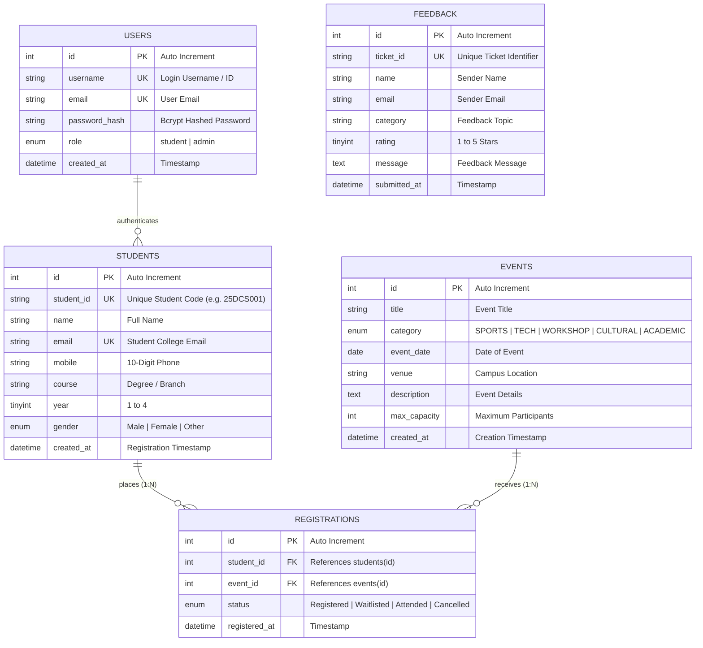

# StudentHub Portal - ER Model, Relational Schema & Database Documentation (Practical 8)

**Subject:** Web Development Frameworks (ITUE203) &bull; Semester 3  
**Institution:** Charotar University of Science and Technology (CHARUSAT) &bull; FTE  

---

## 1. Entity-Relationship (ER) Diagram

---

## 2. Relational Schema & Normalization Analysis (3NF)

### Why is this Schema in Third Normal Form (3NF)?

1. **First Normal Form (1NF):**
   - Each column contains atomic (indivisible) values. No multi-valued attributes or repeating groups (e.g., student contact numbers or registered event arrays are not packed into a single string).
   - Every table possesses a clear Primary Key (`id`).

2. **Second Normal Form (2NF):**
   - The schema is already in 1NF.
   - All non-key attributes are **fully functionally dependent** on the primary key. In the `registrations` junction table, surrogate key `id` is used, and the composite uniqueness is enforced via `UNIQUE KEY (student_id, event_id)`. There are no partial dependencies.

3. **Third Normal Form (3NF):**
   - The schema is in 2NF.
   - There are **no transitive dependencies** ($X \rightarrow Y$ and $Y \rightarrow Z$ where $Z$ depends on non-key $Y$). Every non-prime attribute depends directly and strictly on the primary key ($id \rightarrow attribute$).

---

## 3. Table Relationships & Foreign Keys

| Relationship | Primary Entity | Foreign Entity | Foreign Key Column | Constraint & Cascade Action |
| :--- | :--- | :--- | :--- | :--- |
| **M:N Junction** | `students` (1) | `registrations` (N) | `student_id` | `FOREIGN KEY (student_id) REFERENCES students(id) ON DELETE CASCADE` |
| **M:N Junction** | `events` (1) | `registrations` (N) | `event_id` | `FOREIGN KEY (event_id) REFERENCES events(id) ON DELETE CASCADE` |

> **Cascade Integrity:** When a student or an event is deleted from the database, all corresponding registrations are automatically cleaned up with `ON DELETE CASCADE`, preventing orphaned records.

---

## 4. Key Questions & Viva Answers (Practical 8)

### Q1: Is the schema normalized properly?
**Answer:** Yes. The database follows Third Normal Form (3NF). Student data, Event data, and Registration transactions are stored in separate, dedicated relations. An associative junction table (`registrations`) manages the Many-to-Many ($M:N$) relationship between students and events without redundant data duplication.

### Q2: Are primary keys and foreign keys correctly defined?
**Answer:** Yes. Each table features an auto-incrementing integer `id` as its Primary Key. Foreign keys `student_id` and `event_id` in `registrations` reference `students(id)` and `events(id)` respectively with `ON DELETE CASCADE` and `ON UPDATE CASCADE` referential integrity constraints. Composite uniqueness is enforced with `UNIQUE(student_id, event_id)` to avoid duplicate registrations.

### Q3: Is the database connection handled securely?
**Answer:** Yes. The connection is implemented using PHP Data Objects (**PDO**) in `db.php`:
- Exception handling is configured via `PDO::ATTR_ERRMODE => PDO::ERRMODE_EXCEPTION`.
- Character set is set to `utf8mb4` to support full Unicode and prevent charset-based SQL injection.
- Emulated prepared statements are explicitly disabled (`PDO::ATTR_EMULATE_PREPARES => false`), ensuring true server-side parameterized queries that are immune to SQL injection attacks.

---

## 5. Advanced Extension: Stored Procedures

The database schema includes two production-grade MySQL Stored Procedures:
1. `sp_get_student_registrations(IN p_student_id INT)`:
   - Performs an inner join query across `students`, `registrations`, and `events` to return all registered events for a given student ID.
2. `sp_register_student_event(IN p_student_id INT, IN p_event_id INT, OUT p_result VARCHAR(100))`:
   - Checks if a registration already exists. If not, it executes an atomic insert and returns `'SUCCESS'`; otherwise, returns `'ALREADY_REGISTERED'`.
